<h1 align="center">Tern Stream Deck</h1>

<p align="center">
  Your <a href="https://stencil.so/tern">Tern</a> sessions, your agents and your AI usage, on an Elgato Stream Deck.
</p>

<p align="center">
  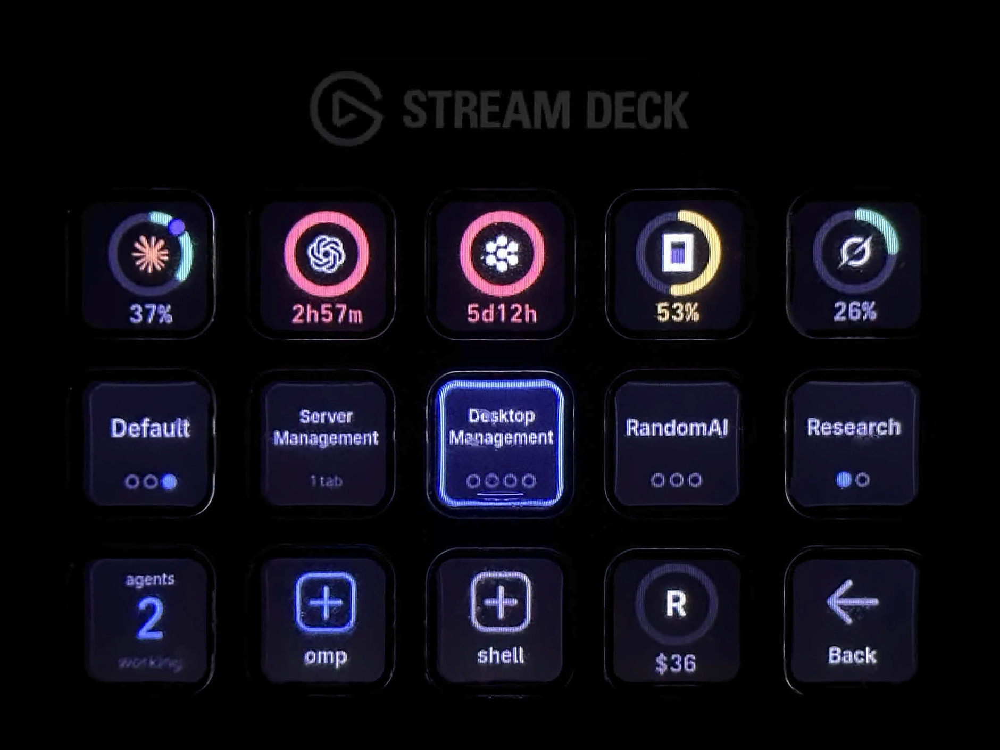
</p>

A plugin for [OpenDeck](https://github.com/nekename/OpenDeck), the open Stream Deck app for Linux. It gives you four kinds of key:

- **Usage rings**: how much of each AI coding subscription you have used. They are the rings that [Usage Rings](https://github.com/WyrmKeep/tern-usage-rings) draws under Tern's tab list, with the same figures.
- **Sessions**: one key per Tern session, with a dot for every agent chat in it. Press to go there.
- **Agents**: how many chats are working and how many have finished while you were elsewhere. Press to jump to the one that has waited longest.
- **New tab**: a fresh tab where you are, with a command already typed if you want one.

The figures come from `omp usage` and the Tern command line. There are no API keys to paste.

<p align="center">
  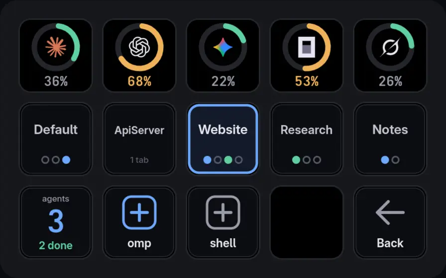
</p>

The camera turns the keys blue; this is what they look like.

## Install

You need:

- Linux with [OpenDeck](https://flathub.org/apps/me.amankhanna.opendeck) 2.14 or later, started once with your deck plugged in
- [Node.js](https://nodejs.org) 22 or later
- [Tern](https://stencil.so/tern) 0.9.26 or later, with omp signed in to at least one account

```sh
git clone https://github.com/WyrmKeep/tern-stream-deck
cd tern-stream-deck
./install.sh --page
```

That installs the plugin, builds the page shown above and restarts OpenDeck. The page is a new profile called **Tern**; your Default page gets one key that opens it.

`--page` is for 15-key decks (Stream Deck MK.2 and the original). On any other deck, run `./install.sh` and drag the keys you want from the **Tern** group at the bottom of OpenDeck's action list.

To update later: `git pull`, then `./install.sh`. That leaves your pages alone.

## The keys

### Usage ring

Each ring is one provider. Several accounts with one provider are pooled into one ring, counted in whichever limit is closest to running out.

| | You see | It means |
| :---: | --- | --- |
| 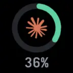 | A green arc and `36%` | The share you have used. |
| 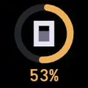 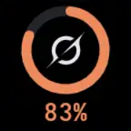 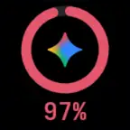 | Amber, orange, red | 50%, 80% and 95% used. |
| 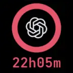 | `22h05m` under a full ring | The limit is used up and resets in 22 hours and 5 minutes. |
| 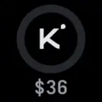 | `$36` | A prepaid balance, for providers that sell credits. |
| 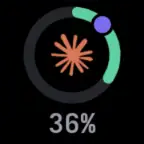 | A purple dot | One account is signed out. Sign in again with omp. |
| 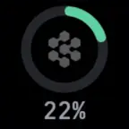 | A dimmed icon | The figure is old: the last refresh failed, or omp only had it in its history. |
|  | `n/a` | omp has no figure for this provider. |

**Press a ring** to see the limits behind it, and press again for when each one resets. A third press, or twelve seconds, brings the ring back.

<p>
  
  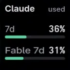
  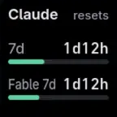
</p>

Claude, Codex, Gemini, OpenCode and Grok are always on offer. Any other provider omp reports, such as Devin or Kimi Code, appears under its own name.

### Session

| | You see | It means |
| :---: | --- | --- |
|  | A blue frame | This is the session Tern is showing. |
| 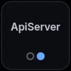 | Dots | One per agent chat, in tab order. Blue is working. Green has finished since you last had its tab up. Hollow is idle. |
| 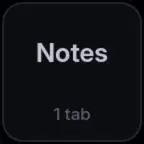 | `1 tab` | No agent chats here, only shells. |

**Press** to show the session on the tab you left it on, with Tern brought to the front. **Press again** to step through its tabs.

A session key follows a place in Tern's session list (first, second, and so on), so the row stays right as you make and delete sessions. You can also pin a key to one session by name.

### Agents

| | You see | It means |
| :---: | --- | --- |
| 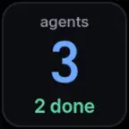 | `3` and `2 done` | Three chats are working. Two have finished and you have not looked at them yet. |
| 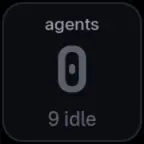 | `0` and `9 idle` | Nothing is running. |

**Press** to jump to the chat that has been finished the longest. Keep pressing to work through the rest.

### New tab

<p>
  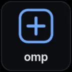
  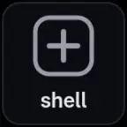
</p>

**Press** for a new tab in the session on screen, in the folder of the pane in front. The command, if the key has one, is typed into the tab's shell, so the tab stays open when the command ends. The page comes with one key for `omp` and one for a plain shell.

## Make it yours

Click a key in OpenDeck and the panel under the keys shows its one setting:

| Key | Setting |
| --- | --- |
| Usage ring | The provider. |
| Session | A place in Tern's list, or one session by name. |
| New tab | The command to type, or nothing for a plain shell. |

Drag more keys from the **Tern** group in the action list, on any page. To get the ready-made page back as it was, run `./install.sh --page` again; it keeps a copy of the page it replaces.

## Good to know

- Rings refresh every five minutes, sessions and agents every two seconds. Nothing is asked while the page with those keys is not on the deck.
- The plugin makes no network requests of its own. It runs `omp usage`, `tern inspect` and a few other `tern` commands, and reads the reading Usage Rings keeps.
- Usage Rings is optional. With it, the deck shows exactly the reading Tern shows. Without it, or with no Tern window open, the deck asks omp itself.
- Bringing Tern to the front works on KDE Plasma. On other desktops the session still changes, and the window stays where it is.
- With several Tern windows, the keys follow the first one.
- After OpenDeck restarts, every dot starts hollow: what finished before is not known.
- Tested on one setup: a Stream Deck MK.2, OpenDeck 2.14.2 from Flathub, Tern 0.9.26, KDE Plasma 6 on Bazzite. The plugin is declared for Linux only.

<details>
<summary>How it works</summary>

OpenDeck starts `plugin.mjs` with Node and talks to it over a WebSocket in the Stream Deck SDK's JSON. When OpenDeck is a Flatpak the plugin still runs on the host, which is why it can reach `tern` and `omp`.

- `lib/usage.mjs` finds the reading. Usage Rings stores omp's answer in Tern's plugin data folder every five minutes; while that copy is under seven minutes old the deck uses it. Otherwise it runs `omp usage --json`, and `omp usage --history` for providers with no live limits, at the same pace.
- `lib/model.mjs` turns a reading into one state per ring. It is a port of Usage Rings' `lib/model.luau`, kept identical by the tests below.
- `lib/tern.mjs` reads `tern inspect --json` and acts with `tern focus`, `tern new tab`, `tern wait` and `tern run`. A chat is a pane with an omp session, or one Tern has reported as working. It asks KWin's window runner to raise the window.
- `lib/draw.mjs` draws every key as an SVG, 144 pixels square, which OpenDeck scales to the deck.
- `pi/` holds the settings panels, and `page.mjs` writes the ready-made page as an OpenDeck profile.

</details>

<details>
<summary>Development</summary>

```sh
node --test test/
```

`test/model.test.mjs` runs every reading in `test/fixtures/` through Usage Rings' own `model.luau` and through `lib/model.mjs`, then compares the rings field by field. It needs [lune](https://lune-org.github.io/docs) (`rokit install` gets the pinned version) and the Usage Rings plugin installed in Tern; set `LUNE` or `USAGE_RINGS_MODEL` to point elsewhere. Without them those tests are skipped and say why. Run it whenever Usage Rings changes its model.

`test/tern.test.mjs` feeds made-up `tern inspect` reports to the session logic.

After changing the plugin, `./install.sh` copies it into OpenDeck and restarts it. The plugin's log is in OpenDeck's log folder, under `plugins/`.

</details>

## Remove

```sh
./install.sh --uninstall
```

Then delete the **Tern** profile, and the key that opens it, in OpenDeck.

## Related

- [Usage Rings](https://github.com/WyrmKeep/tern-usage-rings): the same rings inside Tern, with a card listing every account behind each one.

## License

[MIT](LICENSE). The provider marks in `icons/providers/` belong to their owners; most come from [Lobe Icons](https://github.com/lobehub/lobe-icons) (MIT). This project is not affiliated with Elgato, Stencil or OpenDeck.
